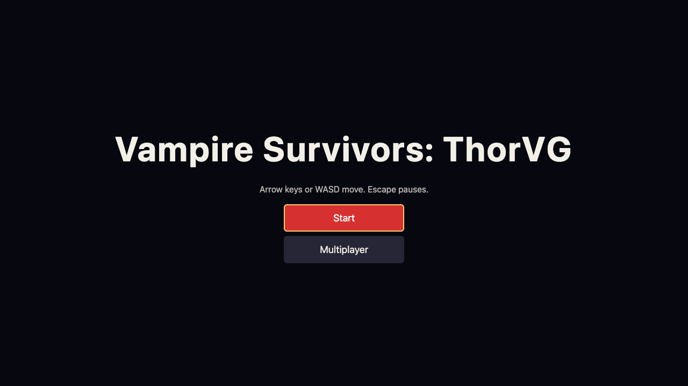
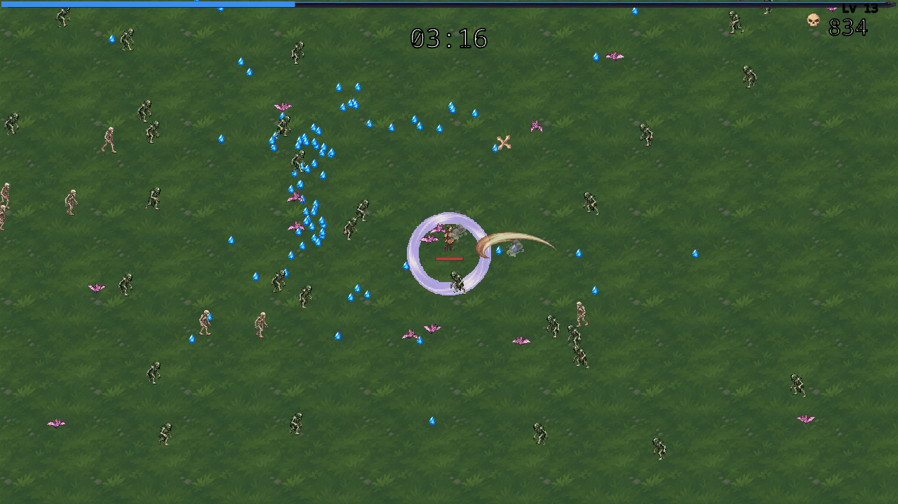
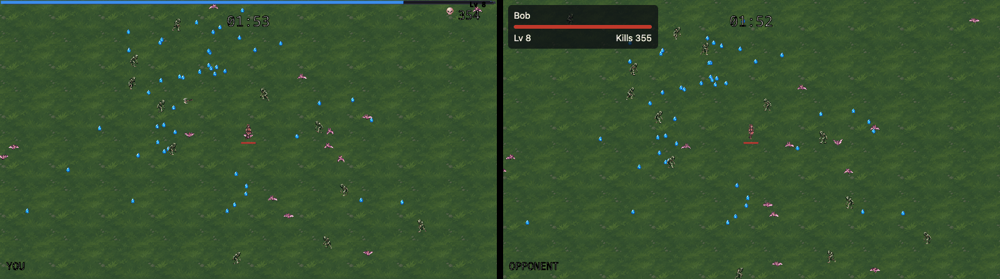

# Crimson Vigil

Repository: `GameJam-Vampire-Survivors` (the game jam's working name)

Survive 15 minutes against ever larger hordes while your weapons fire on their own: a survivors-like browser game for one player, or two in online versus, drawn with ThorVG.

**[Play in your browser](https://ossca-thorvg.github.io/GameJam-Vampire-Survivors/)**: single player works online now; versus runs locally until the game server is public.

| Title screen                               | A run at 3:00                                                    |
| ------------------------------------------ | ---------------------------------------------------------------- |
|  |  |



## Features

- **Single player:** pick a character, survive the 15-minute stage, and see your result with each weapon's damage.
- **4 characters:** Warden, Ember, Swift and Aurelia, each with a starting weapon and stats of their own.
- **8 weapons and 8 passives:** the Whip, Magic Wand, Knife, Axe, Cross, King Bible, Fire Wand and Garlic each go to level 8, and from 5:00 a treasure chest evolves a maxed weapon with its paired passive into one of 8 evolved weapons.
- **One 15-minute stage:** 15 waves over six enemies, a chest carrier each minute before the finale, bosses at 5:00 and 10:00, and Death at 15:00.
- **2-player versus:** meet by a 6-character room code; each player plays their own world from a shared seed, sends Swarm, Gem Thief and Elite Call interference into the other's, and watches both worlds side by side in a split view.
- **ThorVG rendering:** `@thorvg/webcanvas` (WebGL) draws the world and the HUD in a Web Worker on an `OffscreenCanvas`, so the page stays responsive.
- **Performance overlay:** open any build with `?perf` for a live frame-timing overlay.

## How to play

| Action                 | Keys                                   |
| ---------------------- | -------------------------------------- |
| Move                   | Arrow keys or `W` `A` `S` `D`          |
| Pause and resume       | `Escape` (single player)               |
| Navigate menus         | Arrow keys (or `W`/`S`), `Enter` picks |
| Pick a level-up choice | `1`–`3`, or arrows and `Enter`         |

On a phone or tablet (landscape), play by touch: drag anywhere on the game to move with the floating joystick, tap **Pause** at the top right to pause, and tap the buttons and cards of every screen. In touch mode the game fills the whole screen: the view is cropped evenly instead of letterboxed, so everything is larger and a little less of the world is visible. A screen narrower than about 1.69:1 (a 4:3 tablet) is cropped only slightly and keeps bars above and below, so the HUD always fits. Portrait shows a "rotate your device" hint and pauses a single-player run.

| Action (touch)   | Touch                                                      |
| ---------------- | ---------------------------------------------------------- |
| Move             | Drag anywhere on the game; the joystick follows your thumb |
| Pause and resume | **Pause** button (single player), then **Resume**          |
| Menus and cards  | Tap a button or card; a chest closes with a tap            |

- Survive until 15:00. Weapons attack on their own; you only move.
- Killed enemies drop experience gems. Collect them to level up and pick a new or upgraded weapon or passive item.
- In versus, the first to reach 15:00 alive wins; a player who dies first keeps watching while the other plays on, and if both die, the one who lasted longer wins. The HUD's `MATCH mm:ss` counts down the server's 25-minute limit; when it runs out, the most kills win among those still alive.

## Current state

- A 7-second "Powered by ThorVG" splash plays first while the assets load; the title follows once both are done.
- The full single-player loop: title, character select, the run with its HUD listing weapon and passive levels, pause, level-ups, chests and results with Retry.
- The complete stage: 15 waves, a chest carrier from 1:00 through 14:00, and Death at 15:00.
- All 8 weapons with their 8 evolutions, and all 8 passives.
- Animated pixel art for every actor and effect (native Lottie playback).
- 17 sound effects and 2 original chiptune music loops, synthesized with ZzFX and ZzFXM as MP3 assets, played after the first key or click: title and stage music that ducks under the pause and dialogs, weapon hits, kills, gems and menu clicks; `M` or the corner button mutes, and the pause screen sets the music and effects volume (#128, #129).
- Personal records saved in the browser for single-player runs: "New best!" on the results, each character's best time and clear on its card, and a Records screen with bests, totals, the last 10 runs and weapon bests (#143).
- A stage tuned for playability with a headless balance probe: normal enemies are slower than every character, each wave caps its live crowd, contact damage is lower and every character starts with a built-in PowerUp equivalent, so an ordinary run survives well past the 5:00 boss (#148).
- Touch controls for phones and tablets: a floating joystick, a Pause button, tappable screens, no page scroll or zoom, sound on the first tap, and a rotate hint in portrait (#149). The game fills the screen with a cropped view instead of black bars (#171).
- Versus matches against the WebSocket server: lobby, countdown, interference items, split view, the first clear wins under a 25-minute deadline counted down in the HUD, Win/Lose/Draw and Rematch.
- The client is published to GitHub Pages; the server is built and run on the owner's own host and has no public domain yet.

Planned work: [`docs/roadmap.md`](docs/roadmap.md).

## Run it locally

You need Git, nvm, Docker (for the versus server) and Node 24 from `.nvmrc`. Once per clone:

```sh
nvm use               # Node 24 from .nvmrc
corepack enable       # the pnpm version pinned in package.json
pnpm install          # npm and yarn are rejected; also installs the pre-commit hook
cp .env.example .env
```

Then:

```sh
pnpm server:up        # the versus server in Docker on :8787
pnpm dev              # the client on http://localhost:5173
pnpm check            # format, lint, typecheck, tests and build; CI runs the same
pnpm build
```

Full command list: [`CLAUDE.md`](CLAUDE.md) § Commands.

## Deploy

[ADR 0017](docs/adr/0017-host-on-github-pages-and-a-self-hosted-server.md) records the hosting, and [ADR 0023](docs/adr/0023-build-the-server-image-on-the-owners-host.md) how the server image is built.

- Every push to `main` builds the client and publishes it to GitHub Pages.
- No server image is published: the owner builds it from a clone on their own host and runs it with [`deploy/server/compose.yaml`](deploy/server/README.md).
- Once the server has a domain and TLS, the repository variable `VITE_SERVER_URL` turns on versus in the Pages build.

## Contributing

- Start with [`CLAUDE.md`](CLAUDE.md) § Getting started, or [`AGENTS.md`](AGENTS.md) if you use Codex.
- Every change is a GitHub issue first: `issue-start`, implement, then `issue-finish`, which opens one squash-merged PR.
- `main` is protected by a ruleset that nobody can bypass ([ADR 0015](docs/adr/0015-protect-main-with-a-ruleset-and-native-auto-merge.md)).

Where to look:

- [`AGENTS.md`](AGENTS.md): the Codex contributor guide, stage checks, and equivalents for Claude Code tools.
- [`CLAUDE.md`](CLAUDE.md): how to start contributing (Getting started), the shared workflow, rules, and skills for Claude Code and Codex.
- [`docs/roadmap.md`](docs/roadmap.md): the phases and the issues in dependency order.
- [`docs/adr/`](docs/adr/README.md): the architecture decisions every change follows.
- [`REQUIREMENTS.md`](REQUIREMENTS.md): the requirements, in Korean.

## Credits

- Rendering: [ThorVG](https://github.com/thorvg/thorvg) through `@thorvg/webcanvas`.
- HUD font: Noto Sans Mono, under the SIL Open Font License ([ADR 0013](docs/adr/0013-bundle-a-hud-font-subset.md)).
- Art: see [`assets/README.md`](assets/README.md#sources-and-licenses) § Sources and licenses.
